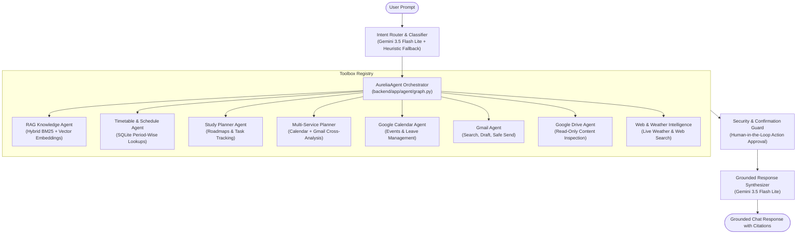

# AURELIA AI — Personal Intelligence & Productivity Platform

<div align="center">


[](https://fastapi.tiangolo.com/)
[](https://react.dev/)
[](https://ai.google.dev/)
[](https://tailwindcss.com/)
[](https://www.sqlite.org/)
[](LICENSE)

**Your life, coursework, and daily operations in one intelligent command center.**  
A unified personal AI assistant combining Google Workspace (Calendar, Gmail, Drive), academic course documents (RAG), structured timetables, and autonomous study roadmaps.

[Live Features](#-key-features) • [Architecture](#-system-architecture) • [Getting Started](#-getting-started) • [API & Integrations](#-google-workspace--api-configuration) • [Testing](#-verification--test-suite)

</div>

---

## ✦ Overview

**AURELIA AI** is a production-ready, dark-mode personal intelligence assistant engineered for students, researchers, and knowledge workers. It bridges the gap between unstructured conversational AI and deterministic operational tools:

- **Conversational Action Engine:** Chat with Gemini 3.5 Flash Lite to manage your calendar, draft or dispatch emails, inspect drive files, and query coursework.
- **Grounded RAG Pipeline:** Upload syllabi, lecture notes, or textbooks and get answers with verifiable page-level citations.
- **Structured Timetable Intelligence:** Deterministic period-wise timetable lookups (periods 1–8, faculty, rooms, conflict detection) without fuzzy hallucinations.
- **Safety & Privacy by Design:** Consequential write actions (sending emails, deleting plans) require explicit preview cards and human-in-the-loop confirmation. Tenant data and OAuth tokens are protected with AES-256 GCM encryption.

---

## ✦ Key Features

### 1. 🤖 Tool-Augmented Conversational Agent
- **Intent Routing:** Evaluates queries using Gemini with a deterministic regex/keyword fallback.
- **Human-in-the-Loop Confirmation:** High-stakes actions (dispatching emails, deleting plans) generate interactive approval cards before touching external APIs.
- **Contextual Memory:** Multi-turn conversational memory with pronoun resolution (`"Give an example"`, `"Explain 3NF"`) linked to recently cited documents.

### 2. 📅 Google Calendar & Leave Management
- **Natural Language Scheduling:** *"Add Deep Learning Quiz today at 10 PM"* or *"Schedule project sync tomorrow at 3 PM"*.
- **Conflict Detection:** Identifies overlapping commitments and flags free intervals.
- **Sick Leave & Holidays:** *"I'm unwell today; mark leave and clear study blocks"* automatically handles calendar reorganization.

### 3. ✉️ Gmail Intelligence & Communication
- **Smart Inbox Search:** Summarizes recent threads, flags urgent messages, and extracts professor assignment deadlines.
- **AI Drafting & Live Dispatch:** Composes professional emails and dispatches them via the Gmail API upon user confirmation.
- **Drafts Folder Sync:** Automatically saves messages to your Gmail Drafts folder on request.

### 4. 📁 Google Drive Search & Inspection
- **Read-Only Cloud Discovery (`drive.readonly`):** Search Drive files by name or full-text keywords.
- **Format Extraction:** Exports and reads Google Docs (`.gdoc`), parses Google Sheets (`.gsheet`) as CSV, and previews PDFs and plain text.
- **Direct Citations:** Answers include clickable external links to open files directly in Google Drive.

### 5. 📚 High-Precision RAG Knowledge Base
- **Filename-Independent Discovery:** Questions like *"What topics are covered in Unit 3?"* discover relevant syllabus documents automatically.
- **Structural Heading Recognition:** Indexes units, chapters, modules, and Markdown headers (`[Section: UNIT 3: NORMALIZATION]`).
- **Hybrid Search Fusion:** Combines BM25 lexical keyword matching with 128-dimensional dense vector embeddings.
- **Adjacent-Chunk Windowing:** Pulls surrounding context for complete, coherent explanations.

### 6. 🗓️ Manual & Structured Academic Timetable
- **Weekly Multi-Day Support:** Configurable timetables covering Monday through Saturday/Sunday.
- **Period-Wise Precision:** Exact lookups by period number (*"Monday period 1"*), time ranges (*"classes between 10 AM and 1 PM"*), or next upcoming class.
- **Faculty & Room Tracking:** Instant resolution of instructor names, lecture halls, and lab sessions.

### 7. 🎯 Smart Study Planner & Roadmap Generator
- **Duration-Adaptive Plans:** Automatically generates milestone roadmaps for 7-day, 14-day, 30-day, or custom goals.
- **Timetable-Aware Slot Generation:** Proposes study blocks during verified free periods and off-hours.
- **Google Calendar Sync:** Syncs proposed study sessions into Google Calendar with one click.

---

## ✦ System Architecture



---

## ✦ Project Structure

```
PERSONAL-AI-ASSISTANT/
├── frontend/                     # React 19 + Tailwind CSS + Vite
│   ├── src/
│   │   ├── components/           # BrandLogo, Navbar, ProductPreview
│   │   ├── config/               # brand.ts (central brand styling)
│   │   ├── features/
│   │   │   ├── landing/          # Cinematic landing page
│   │   │   ├── auth/             # Google Sign-in & Developer login
│   │   │   ├── dashboard/        # Command center overview
│   │   │   ├── chat/             # AI canvas with action confirmation cards
│   │   │   ├── calendar/         # Agenda, scheduler & conflict view
│   │   │   ├── knowledge/        # Personal RAG documents & timetable editor
│   │   │   ├── plans/            # Study roadmaps & progress tracker
│   │   │   └── integrations/     # Google service status hub
│   │   ├── services/             # api.ts (backend API client)
│   │   ├── App.jsx               # Route definitions
│   │   └── main.jsx              # Entry point
│   ├── tailwind.config.js
│   ├── vite.config.js
│   └── package.json
│
├── backend/                      # Python 3.12 + FastAPI + SQLAlchemy
│   ├── app/
│   │   ├── agent/                # AureliaAgent graph & ToolRegistry
│   │   ├── api/routes/           # auth, chat, gmail, calendar, knowledge, plans, timetable
│   │   ├── core/                 # config, security (AES-256 GCM), logging
│   │   ├── db/                   # models, session, migrations
│   │   ├── rag/                  # chunking, embeddings, hybrid retrieval
│   │   ├── prompts/              # routing, rag, gmail, calendar prompts
│   │   └── services/             # google_oauth, google_services, study_plan_generator
│   ├── tests/                    # 75+ automated pytest regression tests
│   ├── requirements.txt
│   ├── Dockerfile
│   └── pytest.ini
│
├── docker-compose.yml            # Containerized full-stack deployment
├── .gitignore                    # Comprehensive secrets & build ignores
└── README.md
```

---

## ✦ Getting Started

### 1. Prerequisites
- **Python 3.11+**
- **Node.js 18+** & **npm**
- *(Optional)* **Docker & Docker Compose**

---

### 2. Backend Setup

```powershell
# Navigate to backend
cd backend

# Create virtual environment
python -m venv .venv

# Activate virtual environment
# Windows (PowerShell):
.\.venv\Scripts\Activate.ps1
# Linux / macOS:
source .venv/bin/activate

# Install dependencies
pip install -r requirements.txt

# Start backend server with hot-reload
python -m uvicorn app.main:app --host 127.0.0.1 --port 8000 --reload
```
Interactive API documentation will be available at: **http://127.0.0.1:8000/docs**

---

### 3. Frontend Setup

In a new terminal window:

```powershell
# Navigate to frontend
cd frontend

# Install npm packages
npm install

# Start Vite dev server
npm run dev
```
Open **http://localhost:5173** in your browser.

---

### 4. Running with Docker Compose

To run the entire stack with a single command:

```bash
docker-compose up --build
```

---

## ✦ Google Workspace & API Configuration

AURELIA AI is designed to run seamlessly in local development out of the box. To connect real Google services:

### Step 1: Create a Google Cloud Project
1. Visit the [Google Cloud Console](https://console.cloud.google.com/).
2. Create a project (e.g., `Aurelia-AI`).
3. Enable the following APIs under **APIs & Services**:
   - **Google Identity (OAuth 2.0)**
   - **Google Calendar API**
   - **Gmail API**
   - **Google Drive API**

### Step 2: Configure OAuth Consent Screen & Scopes
1. Select **External** User Type.
2. Add the following scopes:
   - `openid`, `email`, `profile`
   - `https://www.googleapis.com/auth/calendar.events`
   - `https://www.googleapis.com/auth/gmail.readonly`
   - `https://www.googleapis.com/auth/gmail.compose`
   - `https://www.googleapis.com/auth/gmail.modify`
   - `https://www.googleapis.com/auth/drive.readonly`
3. Add your personal Google account under **Test Users**.

### Step 3: OAuth Credentials & Environment Setup
Create a **Web Application** OAuth Client ID:
- **Authorized JavaScript Origins:** `http://localhost:5173`
- **Authorized Redirect URIs:** `http://localhost:8000/api/auth/google/callback`

Populate `backend/.env`:
```env
# Application Settings
SECRET_KEY=your-32-byte-secret-key-here
ENCRYPTION_KEY=your-32-byte-hex-encryption-key-here
FRONTEND_URL=http://localhost:5173

# Google OAuth 2.0
GOOGLE_CLIENT_ID=your-client-id.apps.googleusercontent.com
GOOGLE_CLIENT_SECRET=your-client-secret
GOOGLE_REDIRECT_URI=http://localhost:8000/api/auth/google/callback

# Google Gemini API
GEMINI_API_KEY=your-gemini-api-key
GEMINI_MODEL=gemini-3.5-flash-lite
```

---

## ✦ Verification & Test Suite

The repository includes a comprehensive, multi-layer automated test suite with **75+ passing tests**:

```powershell
# Run all tests from backend directory
cd backend
$env:PYTHONPATH='.'
python -m pytest tests/ -v
```

### Verified Test Suites:
| Test Suite | Focus Area | Status |
| :--- | :--- | :---: |
| `test_rag_discovery_and_retrieval.py` | First-turn syllabus discovery, unit scoring, tenant isolation | **10 / 10 PASSED** |
| `test_rag_evaluation.py` | Multi-doc comparison, factual QA, technical identifier retrieval | **14 / 14 PASSED** |
| `test_rag_pipeline_regression.py` | Verbatim snippet integrity, rate-limiting & fallback | **8 / 8 PASSED** |
| `test_period_wise_timetable.py` | Period 1–8 lookups, Saturday schedules, time ranges | **16 / 16 PASSED** |
| `test_manual_timetable_chatbot.py` | End-to-end chatbot timetable interactions & updates | **12 / 12 PASSED** |
| `test_manual_timetable_api.py` | Timetable CRUD, period validation, tenant isolation | **8 / 8 PASSED** |
| `test_rag_preservation.py` | Chunk boundary integrity & document persistence | **7 / 7 PASSED** |

---

## ✦ Security & Safety Principles

1. **Principle of Least Privilege:** Google Drive permissions are strictly read-only (`drive.readonly`). Email deletion is blocked by design to prevent accidental data loss.
2. **AES-256 GCM Token Encryption:** Google OAuth tokens are encrypted at rest using AES-GCM with authenticated tags.
3. **Strict Tenant Isolation:** All SQL queries and vector retrieval steps explicitly filter by authenticated `user_id`.
4. **Human-in-the-Loop Action Guards:** The agent cannot dispatch emails or delete roadmaps without presenting an interactive confirmation card to the user.

---

## ✦ Author & Repository

- **Repository:** [https://github.com/Pavankm70/PERSONAL-AI-ASSISTANT](https://github.com/Pavankm70/PERSONAL-AI-ASSISTANT)
- **Maintainer:** [Pavankm70](https://github.com/Pavankm70)

---

## ✦ License

This project is licensed under the [MIT License](LICENSE).
